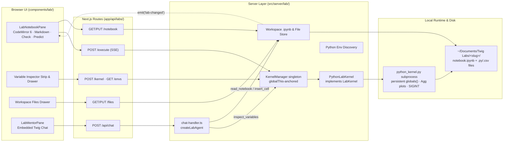

# Implementation Plan — Twig Lab (Replacing Capstone)

## Goal Description

Replace Twig’s read-only, external-editor **Capstone** mode (`kind: "capstone"`) with **Twig Lab** (`kind: "lab"`): a fast, split-pane, Jupyter-inspired interactive programming studio designed for guided Python practice (`core Python`, `numpy`, `matplotlib`, `pytorch`, etc.) and project building, architected behind a language-agnostic kernel protocol so additional languages (JS/TS, C++, Rust, SQL) can plug in later.

### Why this change
- **Current Practice (`code-exercises`)** runs Python inside browser Pyodide (WASM cold start, stateless one-shot snippets, no real local packages/GPU/filesystem, single-cell dock only).
- **Current Capstone** is chat-only, read-only, requires graph picks, refuses to guide or execute code, and forces learners outside Twig.
- **Twig Lab** unifies guided learning and hands-on building in one split-pane workspace: a live, folder-backed `.ipynb` notebook running on a real persistent local Python kernel on the left, paired with a notebook-aware Twig AI Mentor on the right.

---

## Architecture Overview

### Locked Design Decisions (Confirmed with User)
1. **Name & Replacement:** Named **Lab** (`ChatKind: "lab"`, route `/chat/new?mode=lab`, badge/filter `"Lab"`). Capstone tools, prompts, cards, and creation UI are cleanly removed; any pre-existing saved `kind: "capstone"` records on disk render safely in read-only archived mode without crashing.
2. **Folder-Backed `.ipynb` Source of Truth:** Every Lab binds to a real directory on disk — defaulting to `~/Documents/Twig Labs/<slug>/notebook.ipynb` (configurable in Settings), or any existing folder the user picks (reusing Electron’s existing `window.lhDesktop.chooseAttachmentFolder()` dialog with a path-input fallback on web). Standard **Jupyter nbformat v4.5** with Twig metadata under `metadata.twig` so notebooks open natively in VS Code / JupyterLab and can import local `.py` modules or read local datasets right beside them.
3. **Code Editor:** **CodeMirror 6** inside notebook code cells and workspace file editor, themed cleanly to Twig’s CSS design tokens (`#141414` / `#1C1C1C` / `#434343`, warm gold/periwinkle palette, dark + light themes, no browser focus rings).
4. **Execution Engine:** Language-agnostic `LabKernel` interface + v1 **built-in persistent Python worker** (`src/server/lab/python_kernel.py`) requiring zero third-party installs (`ipykernel` not needed). Works out of the box with any local `python3`, `.venv`, `conda`, `uv`, or `pyenv` interpreter.
5. **Mentor Ownership Law:** Mentor tools may insert new cells (Markdown, starter Code, Check, Predict-before-Run) and edit only unedited mentor-authored cells; **mutating learner-authored or learner-edited cells is hard-refused at the tool boundary**.
6. **v1 Feature Set:**
   - Split-pane resizable workspace (Notebook left + Twig Mentor right)
   - Code cells, Markdown/KaTeX cells, **Check/Verification cells**, and **Predict-before-Run cells**
   - Streaming `stdout`/`stderr`, inline `matplotlib`/PIL/SVG plots, HTML DataFrame tables, formatted tracebacks, `Run All`, `Interrupt`, `Restart`
   - **Python interpreter / environment picker** (auto-detect `.venv`, `conda`, `uv`, `pyenv`, system `python3` + custom path + Settings defaults)
   - **Live Variable Inspector** (bottom strip + expandable drawer showing `ndarray`/`torch.Tensor` shape, dtype, device, and previews)
   - **Workspace file browser drawer** (view/create/edit `.py`, `.csv`, `.json`, `.md`, `.txt` files inside the bound Lab directory)
   - One-click cell actions (*"Ask mentor"*, *"Debug this error"*, *"Review cell"*)
   - Optional graph picks (never required to start a Lab)

> [!NOTE]
> **Deferred to v2 (out of scope for this plan):** Standalone "Import arbitrary external `.ipynb` file" wizard (binding an existing folder containing `notebook.ipynb` already works in v1), explicit gap-report `"Teach these"` / `"Practice these"` seeded session handoff cards, and non-Python kernel adapters (JS/TS, C++, Rust, SQL — for which v1 establishes the clean `LabKernel` interface).

---

## User Review Required

> [!IMPORTANT]
> **New npm dependencies (CodeMirror 6):** Adding `@codemirror/state`, `@codemirror/view`, `@codemirror/commands`, `@codemirror/language`, `@codemirror/lang-python`, `@codemirror/autocomplete`, and `@lezer/highlight` (~50 KB gzipped client bundle). No native Node addons are added, so Electron packaging remains pure JS + Python script.

> [!IMPORTANT]
> **Capstone removal & legacy records:** All Capstone authoring UI, tools (`brief`, `review`, `evaluate`, `gap_report`), prompts, and capstone-specific tests will be removed. Pre-existing `data/chats/*.json` files with `kind: "capstone"` remain readable in read-only archived mode (no destructive migration or deletion of user data).

> [!WARNING]
> **Deleting a Lab session never deletes your workspace folder:** `DELETE /api/chats/[id]` shuts down any running kernel and deletes Twig’s chat JSON record, while leaving `~/Documents/Twig Labs/<slug>/` (and your `.ipynb` / `.py` files) completely intact on disk.

---

## Proposed Changes

Changes are ordered bottom-up across Twig’s strict ESLint architecture boundaries (`src/core` → `src/store` → `src/server` → `src/agent` → `app/api` → `components` → packaging/docs/tests).

---

### 1. Core Contracts, `.ipynb` Codec & Settings (`src/core/`)

Strict rule (`eslint.config.mjs`): pure TypeScript, browser-safe (zero `node:*` imports in barrel-exported modules), zero imports from `src/agent`, `src/server`, or `src/store`.

#### [NEW] [lab.ts](file:///home/amogh/Documents/twiglatest/src/core/contracts/lab.ts)
Pure domain types for Lab sessions, notebook cells, outputs, kernel status, variables, and environments:
- `LabLanguage = "python"` (extensible union for future kernels).
- `LabSessionMeta`: `{ workspaceDir: string; notebookFile: string; language: LabLanguage; interpreterPath?: string }`.
- `LabCellRole = "code" | "markdown" | "check" | "predict"`.
- `LabCellAuthor = "learner" | "mentor"`.
- `LabCheckResult`: `{ passed: boolean; summary: string; passedCount?: number; totalCount?: number }`.
- `LabPredictionState`: `{ prompt: string; answer?: string; submittedAt?: string; revealed?: boolean }`.
- `LabOutput`: discriminated union mirroring Jupyter nbformat 4 outputs (`stream`, `display_data`, `execute_result`, `error`).
- `LabCell`: `{ id: string; cellType: "code" | "markdown"; role: LabCellRole; author: LabCellAuthor; learnerEdited: boolean; title?: string; source: string; executionCount: number | null; durationMs?: number; outputs: LabOutput[]; checkResult?: LabCheckResult; prediction?: LabPredictionState; extraMetadata?: Record<string, unknown> }`.
- `LabNotebook`: `{ nbformat: 4; nbformatMinor: 5; language: LabLanguage; cells: LabCell[]; extraMetadata?: Record<string, unknown> }`.
- `KernelStatus = "idle" | "busy" | "starting" | "dead" | "error"`.
- `KernelVariable`: `{ name: string; typeName: string; summary: string; shape?: number[]; dtype?: string; device?: string; sizeHint?: string }`.
- `PythonEnvInfo`: `{ path: string; label: string; version: string; kind: "workspace-venv" | "venv" | "conda" | "uv" | "pyenv" | "system" | "custom"; packages: string[] }`.
- `LabWorkspaceFile`: `{ path: string; name: string; kind: "file" | "dir"; sizeBytes?: number; editable?: boolean }`.
- `LabStreamEvent`: SSE wire events emitted by `POST /api/labs/[chatId]/execute`.

#### [NEW] [lab-ipynb.ts](file:///home/amogh/Documents/twiglatest/src/core/lab-ipynb.ts)
Pure nbformat v4.5 parser, serializer, helper transforms, and model-context summarizer:
- `parseIpynb(rawJson: string): LabNotebook` — accepts standard Jupyter `.ipynb` (both string and `string[]` `source`, nbformat 4.0–4.5), synthesizes deterministic ids if missing, reads `cell.metadata.twig`, and preserves any unknown notebook/cell metadata verbatim.
- `serializeIpynb(notebook: LabNotebook): string` — outputs valid nbformat v4.5 JSON (`source` formatted as Jupyter-standard line arrays ending in `\n` except last line) with Twig fields nested cleanly under `metadata.twig`.
- `createEmptyLabNotebook(title: string, language?: LabLanguage): LabNotebook` — starter notebook with one Markdown title cell and one empty Python code cell.
- `summarizeNotebookForModel(notebook: LabNotebook, opts?: { maxOutputChars?: number }): string` — compact structured digest for the Lab mentor (cell `[n]`, id, role, author, source, truncated stdout/stderr, check pass/fail, prediction prompt + answer, traceback, and `[image/png plot present]` markers).
- `slugifyLabFolderName(title: string): string` — safe filesystem slug generator.

#### [MODIFY] [chat.ts](file:///home/amogh/Documents/twiglatest/src/core/contracts/chat.ts)
- Update `ChatKind` from `"teach" | "practice" | "capstone"` to `"teach" | "practice" | "lab"`.
- Export `PersistedChatKind = ChatKind | "capstone"` and `isLegacyCapstone(kind: unknown): kind is "capstone"` for graceful read-only handling of pre-existing capstone records on disk.
- Add optional `lab?: LabSessionMeta` field on `ChatRecord` (`CURRENT_CHAT_VERSION` stays `2` — pure additive field).
- Remove capstone-only `latest?: boolean` comment/field on `ArtifactPartProps.part` if unused elsewhere.

#### [MODIFY] [settings.ts](file:///home/amogh/Documents/twiglatest/src/core/settings.ts)
- Add optional delta-shaped `lab?: LabSettings` (`{ defaultRootDir?: string; pythonPath?: string }`) to `UserSettings`, `FACTORY_SETTINGS`, and `sanitizeUserSettings` (no `CURRENT_SETTINGS_VERSION` bump).

#### [MODIFY] [events.ts](file:///home/amogh/Documents/twiglatest/src/core/events.ts)
- Add `"lab-changed": { chatId: string; revision?: string; focusCellId?: string }` to `ServerEvents` and `SERVER_EVENT_TYPES` so mentor cell insertions immediately sync and highlight in the open Lab pane.

#### [MODIFY] [prompt-segments.ts](file:///home/amogh/Documents/twiglatest/src/core/prompt-segments.ts)
- Replace `"capstone"` with `"lab"` in `PromptAgent` and `isValidSegmentPath`.

#### [MODIFY] [native-messages.ts](file:///home/amogh/Documents/twiglatest/src/core/native-messages.ts), [view.ts](file:///home/amogh/Documents/twiglatest/src/core/view.ts), [compaction.ts](file:///home/amogh/Documents/twiglatest/src/core/compaction.ts), [source-organization.ts](file:///home/amogh/Documents/twiglatest/src/core/source-organization.ts), [ports.ts](file:///home/amogh/Documents/twiglatest/src/core/ports.ts), [index.ts](file:///home/amogh/Documents/twiglatest/src/core/index.ts)
- Remove `CAPSTONE_BRIEF_TOOL`, `CapstoneBrief`, `capstoneBriefOf` from `native-messages.ts`.
- Remove capstone `latest` evaluation fold from `view.ts`.
- Update `ChatStore.createChat(title, kind?: "practice" | "lab", opts?: { lab?: LabSessionMeta })` and add `saveLabMeta(id: string, lab: LabSessionMeta): boolean` in `ports.ts`.
- Update `source-organization.ts` & `compaction.ts` to treat `"lab"` (and legacy `"capstone"`) as non-extracting sessions like `"practice"`.
- Re-export `contracts/lab.ts` and `lab-ipynb.ts` from `src/core/index.ts`; remove `capstone-parts.ts` re-export.

#### [DELETE] [capstone-parts.ts](file:///home/amogh/Documents/twiglatest/src/core/capstone-parts.ts)

---

### 2. Storage Adapter (`src/store/`)

#### [MODIFY] [chats.ts](file:///home/amogh/Documents/twiglatest/src/store/chats.ts)
- Update `createChat(title, kind?: "practice" | "lab", opts?: { lab?: LabSessionMeta })` to persist `kind: "lab"` and `lab` metadata when provided.
- Add `saveLabMeta(id, lab)` (atomic write without bumping `updatedAt`, matching `saveSettings` / `saveNotes`).
- In `listChats()`, omit full `lab` blob from summary list (or expose compact metadata cleanly) while preserving pre-existing `kind: "capstone"` records safely without crashing.

---

### 3. Lab Server Engine — Workspace, Python Worker & Kernel Manager (`src/server/lab/`)

#### [NEW] [python_kernel.py](file:///home/amogh/Documents/twiglatest/src/server/lab/python_kernel.py)
Self-contained, stdlib-only Python 3 persistent worker script (~280–350 lines):
- **Transport:** Connects back to Node’s local `127.0.0.1:<port>` TCP listener passed via env (`TWIG_KERNEL_PORT`, `TWIG_KERNEL_TOKEN`), authenticates with a one-time 32-byte hex token, and speaks newline-delimited JSON (`execute`, `inspect_vars`, `ping`, `shutdown`). Immune to C-extension / CUDA / PyTorch writes on raw fd 1/2, and cross-platform across Linux, macOS, and Windows.
- **Persistent Namespace:** Maintains one `globals` dict across cell runs (`__name__ = "__main__"`); prepends `os.getcwd()` to `sys.path` so `import helper` from the bound Lab folder works immediately.
- **Execution Semantics:**
  - Parses cell with `ast.parse`; if the final statement is an `ast.Expr`, splits and evaluates it to emit an `execute_result` (Jupyter behavior).
  - Streams `sys.stdout` and `sys.stderr` incrementally in real time.
  - **Matplotlib & Rich Display Auto-Capture:** Sets `MPLBACKEND=Agg`, lazily patches `matplotlib.pyplot.show` (and drains any open `plt.get_fignums()` post-execution), renders figures at 144 DPI to base64 `image/png` (`display_data`), and closes them. Also supports `_repr_png_()`, `_repr_svg_()`, `_repr_html_()` (pandas DataFrames), and `PIL.Image.Image`.
  - **Check Cell Execution (`role == "check"`):** Executes inside the live namespace; splits sequential top-level `ast.Assert` statements (and discovers `def test_*()` functions) so it reports `passedCount / totalCount` and the exact failing assertion message + line.
  - **Tracebacks:** Strips internal `python_kernel.py` frames so line numbers match the learner’s cell 1-to-1.
  - **Interrupt Handling:** Catches `KeyboardInterrupt` cleanly without killing the worker or losing variables in memory.
- **Live Variable Inspector (`inspect_vars`):** Walks user variables in `globals` (skipping dunders, modules, internal helpers) and produces compact `KernelVariable[]` metadata:
  - `numpy.ndarray`: `shape`, `dtype`, compact preview.
  - `torch.Tensor`: `shape`, `dtype`, `device`, `requires_grad`.
  - `torch.nn.Module`: class name + formatted parameter count.
  - `pandas.DataFrame` / `Series`: `shape` + first few column names.
  - Python scalars & containers: type, `len(...)`, truncated `repr` (≤ 120 chars).

#### [NEW] [kernel-types.ts](file:///home/amogh/Documents/twiglatest/src/server/lab/kernel-types.ts)
Defines the language-agnostic `LabKernel` contract (`start`, `execute`, `interrupt`, `restart`, `inspectVars`, `shutdown`, `status`) and `LabKernelFactory` registry type so JS/TS, C++, Rust, and SQL kernels drop in cleanly in v2.

#### [NEW] [python-kernel.ts](file:///home/amogh/Documents/twiglatest/src/server/lab/python-kernel.ts)
Implements `LabKernel` for Python:
- Spins up a per-kernel loopback `net.Server` on `127.0.0.1:0` with a random 32-byte hex handshake token.
- Spawns `interpreterPath` with fixed argv `["-u", PYTHON_KERNEL_SCRIPT]`, `shell: false`, `cwd: workspaceDir`.
- Forwards raw OS `stdout`/`stderr` bytes (e.g. C/CUDA warnings) as `stream` events during an active cell execution.
- Enforces safety caps: per-cell stream cap (100 KiB with truncation notice), image cap (2 MiB/image, max 8 images/cell), startup timeout (10 s).
- Sends `SIGINT` on `interrupt()` (with fallback kill if unresponsive on `shutdown()`).

#### [NEW] [python-envs.ts](file:///home/amogh/Documents/twiglatest/src/server/lab/python-envs.ts)
Auto-discovers local Python interpreters in priority order:
1. Workspace-local `.venv` / `venv` (`bin/python` or Windows `Scripts/python.exe`)
2. Configured Settings default (`settings.lab.pythonPath`)
3. Active env vars (`VIRTUAL_ENV`, `CONDA_PREFIX`)
4. Common `conda` / `mamba` / `miniforge3` / `miniconda3` / `anaconda3` / `pyenv` / `uv` locations
5. System `python3` / `python` on `PATH`

Runs a fast bounded (`2s`) probe script per unique realpath returning Python version + presence of common scientific packages (`numpy`, `matplotlib`, `torch`, `pandas`, `scipy`, `sklearn`), deduplicated and cached in memory with manual refresh.

#### [NEW] [kernel-manager.ts](file:///home/amogh/Documents/twiglatest/src/server/lab/kernel-manager.ts)
`globalThis`-anchored singleton (`__lhLabKernelManager`) managing live kernels per `chatId`:
- `getOrStartKernel(chatId, meta)`
- `executeCell(chatId, req, onEvent)` — serializes executions per chat so `Run All` queues cleanly; persists outputs & check results back into `.ipynb` on completion; emits `lab-changed`.
- `interruptKernel(chatId)`, `restartKernel(chatId)`, `shutdownKernel(chatId)`, `getKernelState(chatId)`.
- Idle reaper (30-minute inactivity timeout) + process exit cleanup hooks (`SIGTERM`, `SIGINT`, `beforeExit`) so no orphaned Python processes remain.

#### [NEW] [workspace.ts](file:///home/amogh/Documents/twiglatest/src/server/lab/workspace.ts)
Folder binding, `.ipynb` atomic read/write, and workspace file operations:
- `defaultLabsRootDir()`: reads `settings.lab.defaultRootDir`, falling back to `path.join(os.homedir(), "Documents", "Twig Labs")`.
- `provisionLabWorkspace({ title, workspaceDir? })`:
  - If `workspaceDir` is provided: expands `~/`, validates directory exists, resolves `realpath`, loads existing `notebook.ipynb` if present or creates a starter `notebook.ipynb` without touching existing files.
  - Otherwise: creates `<defaultLabsRootDir>/<slug>/` (with collision suffix `-2`, `-3`, …) and writes starter `notebook.ipynb`.
- `readLabNotebook(meta)` / `writeLabNotebook(meta, notebook, expectedRevision?)`: computes SHA-256 content revision (same conflict-detection idiom as `Notes`) and writes atomically via `writeFileAtomicSync`.
- `listWorkspaceFiles(workspaceDir)` / `readWorkspaceFile(workspaceDir, relPath)` / `writeWorkspaceFile(workspaceDir, relPath, content)`: strictly confined by `realpath` inside `workspaceDir` (rejecting `..`, escaping symlinks, binary files via 8 KiB NUL heuristic, and >2 MiB files), skipping noisy dirs (`.git`, `.venv`, `venv`, `__pycache__`, `node_modules`, `.ipynb_checkpoints`).

#### [MODIFY] [chat-handler.ts](file:///home/amogh/Documents/twiglatest/src/server/chat-handler.ts), [chats.ts](file:///home/amogh/Documents/twiglatest/src/server/chats.ts), [compaction.ts](file:///home/amogh/Documents/twiglatest/src/server/compaction.ts), [readings.ts](file:///home/amogh/Documents/twiglatest/src/server/readings.ts), [reading-discussions.ts](file:///home/amogh/Documents/twiglatest/src/server/reading-discussions.ts), [index.ts](file:///home/amogh/Documents/twiglatest/src/server/index.ts)
- In `chat-handler.ts`:
  - Route `record.kind === "lab"` to `createLabAgent(...)`, injecting `{ chatId, chatStore, readNotebook, writeNotebook, inspectVariables, getWorkspaceRoot, emitLabChanged }`.
  - Refuse new turns on legacy `kind === "capstone"` with HTTP 400 (`"Archived capstone sessions are read-only."`).
  - Keep `kind === "lab"` out of graph extraction, readings, and reading discussions.
- In `chats.ts` (`deleteChatSession`): call `shutdownKernel(chatId)` on session deletion (never deleting workspace files on disk).
- Export Lab server services from `src/server/index.ts`.

---

### 4. Lab AI Mentor Tools & Coaching Doctrine (`src/agent/`)

#### [NEW] [lab.ts](file:///home/amogh/Documents/twiglatest/src/agent/tools/lab.ts)
The Lab agent’s toolset (mechanics-only descriptions, TypeBox schemas, argument healing via `healToolRecord`):
- `read_notebook`: `{ includeImages?: boolean; cellIds?: string[] }` — returns the live `.ipynb` summary (cell indices, ids, roles, authors, code, execution counts, stdout/stderr, tracebacks, check results, prediction prompts & learner answers). When `includeImages: true`, attaches up to 4 recent PNG plot outputs as native `ImageContent` so vision-capable models can inspect `matplotlib` plots directly.
- `inspect_variables`: `{}` — returns current live kernel variables (`name`, `type`, `shape`, `dtype`, `device`, `summary`) or a clean note if the kernel has not run yet.
- `insert_cell`: `{ cellType: "code" | "markdown"; role: "code" | "markdown" | "check" | "predict"; source: string; title?: string; afterCellId?: string; predictionPrompt?: string }` — inserts a cell stamped `author: "mentor", learnerEdited: false`, writes `.ipynb` atomically, emits `lab-changed` with `focusCellId`, and returns the new cell id + index.
- `update_mentor_cell`: `{ cellId: string; source: string; title?: string; predictionPrompt?: string }` — **hard-enforces ownership**: refuses with `invalidInputResult` if `cell.author !== "mentor"` or `cell.learnerEdited === true` (*"This cell is owned/edited by the learner; do not overwrite it. Discuss in chat or insert a separate cell instead."*).
- `delete_mentor_cell`: `{ cellId: string }` — same mentor-only ownership guard.
- **Scoped Workspace FS Tools:** Reuses `projectFsTools(getRoot)` from [scoped-fs.ts](file:///home/amogh/Documents/twiglatest/src/agent/tools/scoped-fs.ts) (`read`, `ls`, `find`, `grep`), immediately unlocked and confined to `lab.workspaceDir`.

#### [MODIFY] [scoped-fs.ts](file:///home/amogh/Documents/twiglatest/src/agent/tools/scoped-fs.ts)
- Generalize comments and error messages from "capstone brief" to "workspace directory" so it cleanly serves Lab sessions.

#### [NEW] [00-base.md](file:///home/amogh/Documents/twiglatest/src/agent/prompts/lab/00-base.md) & [10-doctrine.md](file:///home/amogh/Documents/twiglatest/src/agent/prompts/lab/10-doctrine.md)
Adapted from Twig’s `teacher/05-method.md`, `practice/10-doctrine.md`, and `docs/style-rubric.md`:
- **`00-base.md` (Workspace & Tool Mechanics):** Explains the split-pane notebook, cell roles (`markdown`, `code`, `check`, `predict`), persistent Python kernel, workspace file access, and the hard rule that the mentor never overwrites learner code. Instructs the mentor to call `read_notebook` (and `inspect_variables` when debugging runtime state) before commenting on learner code.
- **`10-doctrine.md` (Guided Lab Philosophy):**
  - **Motivated steps, not lectures:** Start from the concrete problem (Twig Principle ii: *"How could I have discovered this?"*). Put runnable experiments, small `# TODO` cells, and concrete Check cells (shape + tolerance + edge-case assertions) directly in the notebook rather than walls of chat prose.
  - **Direct answers for direct questions:** Never stall with Socratic games over Python syntax, NumPy/PyTorch APIs, or library ergonomics — answer directly and concisely first.
  - **Runtime-grounded surgical nudges for conceptual bugs:** When a learner hits a logic bug, broadcasting mismatch, or failed Check cell, cite the exact cell, shape, or output evidence and nudge the conceptual gap (escalating smoothly to a concrete worked example if they remain stuck or ask).
  - **Predict-before-Run moments:** Reserve `predict` cells selectively for genuinely counterintuitive mechanics (broadcasting rules, view vs copy aliasing, autograd leaf tensors, closure capture).
  - **Pacing:** Introduce 1–2 small cells at a time rather than dumping an entire 15-cell syllabus upfront.

#### [MODIFY] [teacher-agent.ts](file:///home/amogh/Documents/twiglatest/src/agent/teacher-agent.ts), [prompt-segments.ts](file:///home/amogh/Documents/twiglatest/src/agent/prompt-segments.ts), [prompts/README.md](file:///home/amogh/Documents/twiglatest/src/agent/prompts/README.md)
- Replace `"capstone"` with `"lab"` in `AgentKind`, `composedInstructions`, `CONVERSATION_TOOL_NAMES` (swap `"brief"`, `"evaluate"`, `"gap_report"` for `"read_notebook"`, `"inspect_variables"`, `"insert_cell"`, `"update_mentor_cell"`, `"delete_mentor_cell"`).
- Replace `createCapstoneAgent` with `createLabAgent`.
- In `prompt-segments.ts`: compose `lab/` fragments + `LAB_SHARED_FRAGMENTS = ["10-voice.md", "15-accuracy.md", "40-formatting.md"]`.

#### [DELETE] [capstone.ts](file:///home/amogh/Documents/twiglatest/src/agent/tools/capstone.ts), [00-base.md](file:///home/amogh/Documents/twiglatest/src/agent/prompts/capstone/00-base.md), [10-doctrine.md](file:///home/amogh/Documents/twiglatest/src/agent/prompts/capstone/10-doctrine.md)

---

### 5. HTTP & SSE API Routes (`app/api/labs/` & `app/api/chats/`)

Strict rule: `app/**` imports ONLY `@/src/core` and `@/src/server`.

#### [NEW] [route.ts](file:///home/amogh/Documents/twiglatest/app/api/labs/envs/route.ts)
- `GET /api/labs/envs?chatId=...&refresh=1` — returns discovered `PythonEnvInfo[]` (including workspace-local `.venv` if `chatId` is supplied).

#### [NEW] [route.ts](file:///home/amogh/Documents/twiglatest/app/api/labs/[id]/notebook/route.ts)
- `GET /api/labs/[id]/notebook` — returns `{ meta, notebook, revision, kernelStatus, variables }`.
- `PUT /api/labs/[id]/notebook` — validates notebook payload, writes atomically to `<workspaceDir>/<notebookFile>` with `expectedRevision` conflict check (returns `409` with authoritative server notebook + revision if a mentor insert landed simultaneously so edits never clobber).

#### [NEW] [route.ts](file:///home/amogh/Documents/twiglatest/app/api/labs/[id]/execute/route.ts)
- `POST /api/labs/[id]/execute` (`dynamic = "force-dynamic"`) — accepts `{ cellId, code?, role? }`, syncs latest cell code to `.ipynb`, runs on the chat’s `LabKernel`, and returns an `EventStream` (`text/event-stream`) emitting `LabStreamEvent` chunks in real time until `done`.

#### [NEW] [route.ts](file:///home/amogh/Documents/twiglatest/app/api/labs/[id]/kernel/route.ts)
- `POST /api/labs/[id]/kernel` — handles `{ action: "interrupt" | "restart" | "shutdown" | "inspect_vars" | "set_interpreter", interpreterPath?: string }`.

#### [NEW] [route.ts](file:///home/amogh/Documents/twiglatest/app/api/labs/[id]/workspace/route.ts)
- `POST /api/labs/[id]/workspace` — rebinds `workspaceDir` (shuts down old kernel, provisions/loads `notebook.ipynb` in the new folder, updates `ChatRecord.lab`, emits `lab-changed`).

#### [NEW] [route.ts](file:///home/amogh/Documents/twiglatest/app/api/labs/[id]/files/route.ts) & [route.ts](file:///home/amogh/Documents/twiglatest/app/api/labs/[id]/files/[...path]/route.ts)
- `GET /api/labs/[id]/files` — lists files in `workspaceDir`.
- `GET / PUT / DELETE /api/labs/[id]/files/[...path]` — confined read/create/save/delete for workspace text files (`.py`, `.csv`, `.json`, `.md`, `.txt`, etc.).

#### [MODIFY] [route.ts](file:///home/amogh/Documents/twiglatest/app/api/chats/route.ts)
- Accept `kind: "lab"` + optional `lab?: { workspaceDir?: string; interpreterPath?: string; language?: LabLanguage }`.
- When `kind === "lab"`, call `provisionLabWorkspace(...)` before creating the chat record and stamp `ChatRecord.lab` atomically.

---

### 6. Lab UI — Split Pane, Notebook, CodeMirror 6 & Controls (`components/lab/` & `components/`)

Strict rule: `components/**` imports ONLY `@/src/core` (and `@/components/*`, `@/lib/*`). Obeys Twig’s style laws (4px spacing rhythm, CSS design tokens, zero browser focus outline rings, dark & light mode parity).

#### [NEW] [code-mirror-editor.tsx](file:///home/amogh/Documents/twiglatest/components/lab/code-mirror-editor.tsx)
Reusable CodeMirror 6 wrapper:
- Extensions: `python()` language mode (extensible map keyed by `LabLanguage`), Twig custom theme using CSS variables (`var(--card)`, `var(--foreground)`, `var(--lh-ink-code)`, `var(--lh-ink-italic)`, `var(--muted-foreground)`), auto-indent, bracket matching, `Ctrl+/` comment toggle, `Tab` / `Shift+Tab` indent/dedent, undo/redo history, and keymap callbacks (`Shift+Enter` = run & advance, `Ctrl/Cmd+Enter` = run in place, `Escape` = blur/command mode).
- Auto-grows vertically to fit cell content with no nested scroll trap.

#### [NEW] [cell-outputs.tsx](file:///home/amogh/Documents/twiglatest/components/lab/cell-outputs.tsx)
Renders Jupyter outputs cleanly:
- Streaming `stdout`/`stderr` via existing `ansi-to-react`.
- Inline `image/png` & `image/svg+xml` plots (with click-to-expand lightbox and download button).
- Sanitized HTML tables (`text/html` for pandas DataFrames — stripped of `<script>`, inline event handlers, and external URLs).
- Formatted Python tracebacks with error badge + one-click **"Debug with mentor"** button.

#### [NEW] [notebook-cell.tsx](file:///home/amogh/Documents/twiglatest/components/lab/notebook-cell.tsx)
Renders each cell variant:
- **Code Cell:** Execution gutter `[2]` + Run (`▶`) / Stop (`■`) button + `14ms` duration badge, CodeMirror 6 editor, subtle hover toolbar (`Ask mentor`, `Move Up/Down`, `Insert Below`, `Delete`), and attached `CellOutputs`.
- **Markdown Cell:** Renders prose & KaTeX via Twig’s `MessageResponse`; double-click or click `Edit` to toggle Markdown source editor (`Shift+Enter` commits & renders).
- **Check Cell:** Dedicated subtle verification card styling (`✓ Passed · 3/3 checks` in `--lh-success` or `✗ Failed` in `--lh-error`), `Re-run` button, collapsible assertion editor.
- **Predict-before-Run Cell:** Shows mentor’s `prediction.prompt` + compact learner prediction input above the cell; code is readable immediately; `Run` unlocks on submitting a prediction (or explicit *"Skip prediction"*), then displays *"Your prediction"* directly alongside *"Actual output"*.

#### [NEW] [variable-inspector.tsx](file:///home/amogh/Documents/twiglatest/components/lab/variable-inspector.tsx)
- Compact bottom strip pinned under the notebook pane (`X: ndarray (100, 2) float64 · w: ndarray (2, 1) · losses: list[200]`), clickable to expand into a filterable drawer table (Name, Type, Shape/Size, Dtype/Device, Preview).

#### [NEW] [workspace-files-drawer.tsx](file:///home/amogh/Documents/twiglatest/components/lab/workspace-files-drawer.tsx)
- Collapsible left drawer listing files in the bound Lab directory (`notebook.ipynb`, local `.py` modules, `.csv` data files, etc.).
- Clicking any non-notebook text file opens a clean inline file tab/overlay with CodeMirror 6 + `Save (Ctrl+S)` and `+ New file` button, so learners can extract reusable Python modules right beside their notebook.

#### [NEW] [lab-toolbar.tsx](file:///home/amogh/Documents/twiglatest/components/lab/lab-toolbar.tsx)
- Top bar chrome integrated with Twig’s `TopBar`:
  - Editable session title + quiet `Lab` pill
  - **Kernel & Environment Picker** popover (green/amber/gray status dot, `Python 3.12 · .venv`, auto-detected env list with package badges, custom path input, `Refresh`)
  - `Run All`, `Interrupt` (when busy), `Restart`, `Files` toggle, `Variables` toggle, and `Workspace` popover (shows bound folder path, `"Change folder..."` via Electron dialog / path input, `"Download .ipynb"`).

#### [NEW] [lab-tool-cards.tsx](file:///home/amogh/Documents/twiglatest/components/lab/lab-tool-cards.tsx)
- Quiet transcript cards registered in `components/artifacts/index.ts` for `insert_cell` and `update_mentor_cell` (e.g. `"Inserted Step 3 · Check cell"` with a one-click **"Jump to cell"** button that scrolls & briefly highlights that cell in the left pane).

#### [NEW] [lab-workspace.tsx](file:///home/amogh/Documents/twiglatest/components/lab/lab-workspace.tsx)
Top-level split-pane Lab host:
- Manages notebook state, debounced auto-save to `PUT /api/labs/[id]/notebook` (with `pagehide` flush and `409` merge reconciliation), SSE cell execution queue (`Run` and `Run All`), and `lab-changed` live sync subscription via `/api/events`.
- Resizable vertical split (`role="separator"`, keyboard-accessible, persisted width in `localStorage`, responsive single-pane tab switcher on narrow screens).
- Connects cell actions (*"Ask mentor"*, *"Debug with mentor"*) and transcript card actions (*"Jump to cell"*) cleanly across the split via a lightweight React context (`LabContext`).

#### [MODIFY] [page.tsx](file:///home/amogh/Documents/twiglatest/app/chat/[id]/page.tsx) & [chat.tsx](file:///home/amogh/Documents/twiglatest/components/chat.tsx)
- In `app/chat/[id]/page.tsx`: when `chat.kind === "lab"`, render `<LabWorkspace ... />` (which mounts `<Chat embedded ... />` in its right pane); when `chat.kind === "capstone"`, render `<Chat ... legacyArchived />` (read-only banner, disabled composer).
- In `components/chat.tsx`:
  - Add minimal `embedded?: boolean` (omits outer `TopBar` and `NotesPanel` when hosted inside `LabWorkspace`), `externalPromptDraft?: { id: number; text: string }` (so cell *"Ask mentor"* / *"Debug"* actions populate & focus the composer cleanly), and `legacyArchived?: boolean` (read-only fallback for old capstone sessions).
  - Remove `capstone` phase chip and `SeedNavigationContext` imports from `capstone-cards`.

#### [MODIFY] Navigation, Creation & Settings Surfaces
- [home.tsx](file:///home/amogh/Documents/twiglatest/components/home.tsx): Replace `"capstone"` toggle with `"lab"` (`FlaskConicalIcon`), placeholder *"What do you want to build or practice?"*, graph picks optional (send enabled without picks), optional folder picker chip.
- [new-session.tsx](file:///home/amogh/Documents/twiglatest/components/new-session.tsx) & [page.tsx](file:///home/amogh/Documents/twiglatest/app/chat/new/page.tsx): Replace `mode="capstone"` with `mode="lab"`, remove `CAPSTONE_PICK_HINT` disabled gate, add optional workspace folder picker row.
- [sidebar.tsx](file:///home/amogh/Documents/twiglatest/components/sidebar.tsx): Replace Capstone button/filter/hammer badge with Lab button/filter/flask badge; display archived capstone rows quietly.
- [command-palette.tsx](file:///home/amogh/Documents/twiglatest/components/command-palette.tsx): Replace `action:new-capstone` with `action:new-lab`.
- [start-session.ts](file:///home/amogh/Documents/twiglatest/components/start-session.ts), [composer-actions.tsx](file:///home/amogh/Documents/twiglatest/components/composer-actions.tsx), [chain-table.tsx](file:///home/amogh/Documents/twiglatest/components/chain-table.tsx), [artifacts/index.ts](file:///home/amogh/Documents/twiglatest/components/artifacts/index.ts): swap capstone wiring for lab wiring.
- Settings UI (`components/settings/`): add a concise **Lab** section for `Default Labs folder` (`~/Documents/Twig Labs`) and `Default Python interpreter` (auto-detected dropdown + custom path).

#### [DELETE] [capstone-cards.tsx](file:///home/amogh/Documents/twiglatest/components/capstone-cards.tsx)

---

### 7. Packaging, Docs & Cleanup

#### [MODIFY] [package.json](file:///home/amogh/Documents/twiglatest/package.json)
- Add CodeMirror 6 dependencies (`@codemirror/state`, `@codemirror/view`, `@codemirror/commands`, `@codemirror/language`, `@codemirror/lang-python`, `@codemirror/autocomplete`, `@lezer/highlight`).

#### [MODIFY] [next.config.ts](file:///home/amogh/Documents/twiglatest/next.config.ts) & [build-server.mjs](file:///home/amogh/Documents/twiglatest/scripts/build-server.mjs)
- Include `src/server/lab/python_kernel.py` and `src/agent/prompts/lab/*.md` in `outputFileTracingIncludes` (`next.config.ts`).
- Replace the `src/agent/prompts/capstone/*.md` checks in `scripts/build-server.mjs` with sanity checks for `src/server/lab/python_kernel.py` and `src/agent/prompts/lab/{00-base,10-doctrine}.md`.

#### [NEW] [lab.md](file:///home/amogh/Documents/twiglatest/docs/lab.md) · [MODIFY] [architecture.md](file:///home/amogh/Documents/twiglatest/docs/architecture.md) & [README.md](file:///home/amogh/Documents/twiglatest/docs/README.md) · [DELETE] [capstone.md](file:///home/amogh/Documents/twiglatest/docs/capstone.md)
- Document the Lab architecture, kernel protocol, `.ipynb` schema, mentor ownership law, and folder layout.

---

## Implementation Phases (Execution Order)

1. **Phase 1 — Core Contracts, `.ipynb` Codec & Settings:** `contracts/lab.ts`, `lab-ipynb.ts`, `ChatKind`/`ChatStore`, `events.ts`, `settings.ts`, plus unit tests (`tests/lab-ipynb.test.ts`).
2. **Phase 2 — Local Python Kernel & Workspace Engine:** `python_kernel.py`, `kernel-types.ts`, `python-kernel.ts`, `python-envs.ts`, `kernel-manager.ts`, `workspace.ts`, plus integration tests (`tests/lab-python-kernel.test.ts`, `tests/lab-workspace.test.ts`).
3. **Phase 3 — Lab Agent, Tools & Prompts (and Capstone Removal):** `tools/lab.ts`, `prompts/lab/*`, `teacher-agent.ts`, `chat-handler.ts`, remove Capstone backend files, plus agent & style tests (`tests/lab-agent.test.ts`).
4. **Phase 4 — HTTP/SSE API Routes:** `/api/labs/envs`, `/notebook`, `/execute`, `/kernel`, `/workspace`, `/files`, and `/api/chats` creation hook.
5. **Phase 5 — Lab UI & CodeMirror 6:** Install CodeMirror 6 packages, build `components/lab/*`, integrate `LabWorkspace` in `app/chat/[id]/page.tsx` and embedded `Chat`, update Home / NewSession / Sidebar / CommandPalette / Settings, remove `capstone-cards.tsx`, plus UI tests (`tests/lab-ui.test.tsx`).
6. **Phase 6 — Packaging, Docs & Full Verification:** Update `next.config.ts`, `build-server.mjs`, docs, and run full checks (`lint`, `typecheck`, `test`, `build`, `build-server`, manual end-to-end walkthrough).

---

## Verification Plan

### Automated Tests
1. **New targeted test suites:**
   - `node --import tsx --test tests/lab-ipynb.test.ts` — nbformat v4.5 round-trip, Twig metadata preservation, external Jupyter metadata preservation, model digest truncation.
   - `node --import tsx --test tests/lab-python-kernel.test.ts` — real `python3` worker: persistent namespace across cells, live streaming stdout/stderr, AST last-expression output, Check cell pass/fail counts, traceback line accuracy, `inspect_vars` metadata, `SIGINT` interrupt recovery without losing namespace, restart clearing state, clean shutdown (zero leftover processes).
   - `node --import tsx --test tests/lab-workspace.test.ts` — auto-folder provisioning, existing-folder binding, atomic write + revision conflict detection, realpath escape / symlink rejection.
   - `node --import tsx --test tests/lab-agent.test.ts` — `read_notebook`, `inspect_variables`, `insert_cell`, `update_mentor_cell` hard refusal on learner-owned and learner-edited cells, prompt composition, `node scripts/style-check.mjs --strict src/agent/prompts/lab/10-doctrine.md`.
   - `node --import tsx --test tests/lab-ui.test.tsx` — SSR checks for Lab cells (Code, Markdown, Check, Predict), Lab sidebar/home/new-session (no required graph picks), legacy archived capstone read-only rendering.
2. **Updated existing tests:**
   - `tests/chat-kind.test.ts`, `tests/command-palette.test.tsx`, `tests/notes-preview-shortcuts.test.tsx`, `tests/source-organization.test.ts`, `tests/desktop-payload.test.ts`, `tests/formatting-doctrine.test.ts` (replacing removed capstone assertions with lab assertions; delete `tests/capstone-agents.test.ts` and `tests/capstone-ui.test.tsx`).
3. **Full repository gates:**
   - `npm run lint` — verifies zero ESLint import-boundary violations.
   - `npm run typecheck` — `tsc --noEmit` passes cleanly.
   - `npm test` — entire test suite passes.
   - `npm run build && node scripts/build-server.mjs` — standalone Next + Electron server payload builds cleanly with `python_kernel.py` and `prompts/lab/*.md` verified present.

### Manual Verification
1. Start dev server (`npm run dev`), open Home, select **Lab**, start *"Practice NumPy broadcasting and plot a gradient descent loss curve"* without picking graph nodes.
2. Verify `~/Documents/Twig Labs/<slug>/notebook.ipynb` is created on disk and opens cleanly in VS Code / Jupyter.
3. Select a local `.venv` containing `numpy` + `matplotlib` (and `torch` if installed) from the Kernel picker pill.
4. Run a cell with a loop + `print()` → verify live streaming output and millisecond subsequent runs with persistent variables.
5. Run a `matplotlib` plot cell → verify crisp inline dark/light plot rendering and click-to-zoom.
6. Check the **Variable Inspector** strip & expanded drawer → verify `ndarray` / `torch.Tensor` shapes, dtypes, and devices appear accurately.
7. Ask the mentor to add a **Check cell** and a **Predict-before-Run cell** → verify they appear live in the left pane, the prediction prompt gates execution until answered, and the Check cell displays green/red pass badges.
8. Create a helper `utils.py` inside the **Workspace Files Drawer**, import it from a notebook cell, and verify it executes cleanly.
9. Run `while True: pass` → click **Interrupt** → verify `KeyboardInterrupt` stops execution while previously defined variables remain alive; click **Restart** → verify namespace resets.
10. Trigger an intentional shape mismatch error → click **"Debug with mentor"** → verify the mentor inspects the live notebook/variables and gives a grounded, non-overwriting nudge.
