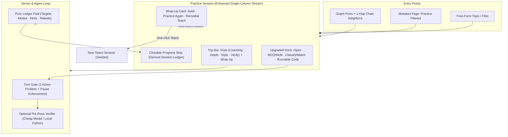

# Implementation Plan — Twig Practice v2

## Goal Description

Redesign Twig's **Practice** mode (`kind: "practice"`) from a minimal two-tool chat wrapper into a first-class, adaptive practice experience that matches the craft of Teaching and Twig Lab—while preserving upstream's strongest pedagogical principles (cold retrieval, interleaving, varied cues, commit-before-pose, and between-problems pauses).

This plan focuses **exclusively on the Practice feature itself**. Spaced-repetition scheduling (`src/core/review.ts` / FSRS-6) is deliberately kept separate and untouched; all existing `problem` / `conclude` records remain backwards-compatible and readable.

---

## User Review Required

> [!IMPORTANT]
> **Scope & Compatibility Guarantees**
> - **Existing practice chats stay readable with zero migrations.** Absent `ChatRecord.practice` falls back to default dials (`coaching: "balanced"`, `depth: "adaptive"`, `presentation: "auto"`, `verifySolutions: false`).
> - **Review / FSRS stays untouched.** Existing `problem` and `conclude` tool names and outcome values stay intact. Flagged bad problems use a new `"voided"` outcome, which `review-events.ts` naturally ignores since it only folds `solved | solvedWithHints | surrendered`.
> - **Plugin problem compatibility preserved.** Plugin-defined practice problems (`docs/plugin-problem-contract.md`) continue sharing the single-active-problem gate and gain the `nextReady` fix.

> [!NOTE]
> **Deferred / Explicitly Out of Scope**
> - FSRS / Review grading changes (deferred to a separate Review pass).
> - Auto-advance / skip-pause mode (decided: always pause after every concluded problem).
> - Fixed problem-count / countdown session timers (decided: open-ended pacing; learner clicks **Wrap up** whenever ready).
> - Mid-session remedial Teach chips on individual cards (decided: keep mid-session cards clean; surface remedial Teach recommendations in the **Wrap-up** card).

---

## Architecture Overview



---

## Proposed Changes

The redesign is structured into **three clean, shippable phases**. Each phase leaves typecheck, lint, build, and all tests green on its own.

---

# Phase 1 — Core Engine, Dials, Neighbor Context, Ledger & Upgraded Dock

### 1.1 Core Contracts, Settings & Pure Domain Helpers

#### [NEW] `src/core/contracts/practice.ts`
Define browser-safe types and defaults for Practice v2 metadata, dials, and dock actions:

```ts
export type PracticeCoachingLevel = "socratic" | "balanced" | "direct";
export type PracticeDepth = "recall" | "adaptive" | "deep";
export type PracticePresentation = "auto" | "theory" | "applied";

export interface PracticeSessionMeta {
	coaching: PracticeCoachingLevel;
	depth: PracticeDepth;
	presentation: PracticePresentation;
	verifySolutions: boolean;
}

export const DEFAULT_PRACTICE_META: PracticeSessionMeta = {
	coaching: "balanced",
	depth: "adaptive",
	presentation: "auto",
	verifySolutions: false,
};

export type PracticeThinkingAction =
	| "submit"
	| "hint"
	| "show-solution"
	| "step-down"
	| "flag-bad";

export interface PracticeSummaryItem {
	area: string;
	note: string;
	targets: string[];
}

export interface PracticeSummaryData {
	summary: string;
	solid: PracticeSummaryItem[];
	needsPractice: PracticeSummaryItem[];
	remedialTeach: PracticeSummaryItem[];
}
```

#### [MODIFY] `src/core/contracts/chat.ts`
- Add optional `practice?: PracticeSessionMeta` to `ChatRecord` and `ChatSummary` (mirroring `lab?: LabSessionMeta`).
- Add single-sourced model-facing labels for structured dock actions (`HINT_REQUEST_PREFIX`, `SHOW_SOLUTION_TEXT`, `STEP_DOWN_TEXT`, `FLAG_BAD_TEXT`).

#### [MODIFY] `src/core/settings.ts`
- Add `PracticeSettings` (`defaultCoaching`, `defaultDepth`, `defaultPresentation`, `defaultVerifySolutions`) to `AppSettings` and `FACTORY_SETTINGS` with sanitizer validation, mirroring `LabSettings`.

#### [MODIFY] `src/core/chains.ts`
- Add pure helper `neighborContextForSelection(pickedNodes, allNodes, allChains, maxNeighbors = 12)`:
  - Finds every stored chain where **at least one** premise or conclusion is in `pickedNodes`, and **at least one** endpoint is outside `pickedNodes`.
  - Collects strict **1-hop chain neighbor nodes** (sorted deterministically by number of shared connecting chains descending, then node id, capped at `maxNeighbors`).
  - Returns `{ neighbors: GraphContextPick[], neighborChains: string[] }` so Discrimination mode has genuine adjacent confusables without pulling in unrelated nodes from the same source.

#### [NEW] `src/core/practice-ledger.ts`
Deterministic, pure, browser-safe fold over `LhMessage[]` (survives compaction completely):
- Reads `graph-context` picks (if any), all cleanly-acked pose calls (native `problem`, Phase 3 `practice_check` / `practice_match` / `practice_code`, and plugin poses), `practice-thinking` actions (counting hints & submissions per active problem), and `conclude` calls.
- Produces `PracticeLedger`:
  - `problemsAttempted`, `problemsSolved`, `problemsWithHints`, `problemsRevealed`, `problemsVoided`.
  - Per-target rollups: `nodeId`, `name`, `status` (`untested | solid | shaky | missed`), `modesTested` (`Set<"recall" | "discrimination" | "composition">`), `attempts`, `highestRung`, `needsRetest`.
  - `retestQueue`: list of targets / brief problem cues still awaiting a fresh-surface retest (cleared automatically once a later non-voided problem tests that target).
  - `activeProblemAttempts` & `activeProblemHints`: counts for the currently open problem (drives the `Balanced` coaching stall rule).
- Exposes `formatPracticeLedgerForPrompt(ledger, meta)`: a compact (~150–300 token) structured block injected into the Practice agent's system prompt on every turn.

#### [MODIFY] `src/core/native-messages.ts`
- Extend `newGraphContextMessage(picks, chains, neighbors?, neighborChains?)` to emit an explicit second section when neighbors exist:
  ```text
  [Nearby context — NOT targets; use only as confusables for discrimination problems]
  - [id] Name: Statement
  Connecting chains:
  - Premise → Conclusion
  ```
- Extend `newThinkingMessage(problemCallId, text, images?, action?)` so `hint`, `show-solution`, `step-down`, and `flag-bad` carry a typed `action` in `details` and unambiguous model-facing framing in `content` (e.g. `[HINT REQUEST]`, `[SHOW SOLUTION — reveal and conclude]`, `[EASIER / STEP DOWN]`, `[FLAG BAD QUESTION — repair or void]`).
- Update `isPracticePoseTool(name)` helper so `activeProblemOf`, `problemInputForConclude`, and `nextReady` recognize native `problem`, Phase 3 pose tools, and plugin poses uniformly.

#### [MODIFY] `src/core/input-events.ts`
- Extend `{ type: "thinking" }` input with optional `action?: PracticeThinkingAction`.
- Allow empty `text` when `action` is `"hint"`, `"show-solution"`, `"step-down"`, or `"flag-bad"` (only `"submit"` requires text or images).

---

### 1.2 Practice Tools, Gate & Prompts

#### [MODIFY] `src/agent/tools/practice.ts`
- **Enforce the Pause Law in `PracticeGate`:**
  - Add `concludedThisTurn: boolean` to `PracticeGate`.
  - `concludeTool` sets `gate.problemActive = false; gate.concludedThisTurn = true;`.
  - `admitPracticeProblem` rejects posing in the same turn after a conclusion (`invalidInputResult`: *"a problem was already concluded in this turn — end your turn and wait for the learner's go-ahead"*) **unless** the conclusion was `outcome: "voided"` (so **Flag bad question** and **Easier / Step down** can cleanly replace the bad/stalled problem immediately).
- Add `"voided"` to `concludeInputObject.outcome` (used for **Flag bad question** and **Step down** replacements so they never pollute Mistakes or Review).
- Update stale file header comment (currently contradicts the pause law).

#### [MODIFY] `src/agent/prompts/practice/00-base.md` & `src/agent/prompts/practice/10-doctrine.md`
- Rewrite coaching/progression rules to honor the live **Session Dials** and **Session Ledger** injected each turn:
  - **Socratic:** Strict one-rung hint ladder; never conclude without solve or explicit `SHOW SOLUTION`.
  - **Balanced (default):** Escalate hints sensibly; after 2–3 stuck attempts (`activeProblemAttempts >= 2` or `activeProblemHints >= 2`), explicitly offer the learner a choice: reveal the solution or step down to an easier problem.
  - **Direct:** On a wrong attempt, localize the break, explain cleanly, and conclude with reveal right away.
- Define exact agent behavior for dock actions:
  - `[HINT REQUEST]` → deliver one rung (scaled to Coaching level) using the learner's draft if provided.
  - `[SHOW SOLUTION]` → immediately call `conclude` (`outcome: "surrendered"`), explain clearly where their reasoning broke, and end the turn.
  - `[EASIER / STEP DOWN]` → call `conclude` (`outcome: "voided"` or `"movedOn"` if they made a genuine attempt), then pose a gentler step on the same target.
  - `[FLAG BAD QUESTION]` → inspect the learner's objection; if the statement was ambiguous or flawed, call `conclude` (`outcome: "voided"`, `retest: false`), briefly acknowledge, and pose a repaired replacement immediately.
- Document how to use the `[Nearby context — NOT targets]` block strictly as confusables for Discrimination mode (never tagging them as targets).

#### [MODIFY] `src/agent/teacher-agent.ts` & `src/server/chat-handler.ts`
- Pass `practiceMeta` (resolved from `record.practice ?? DEFAULT_PRACTICE_META`) and `formatPracticeLedgerForPrompt(foldPracticeLedger(record.messages), practiceMeta)` into `createPracticeAgent`'s per-turn prompt composition.

---

### 1.3 Server Routes & Persistence

#### [MODIFY] `app/api/chats/route.ts`
- Accept optional `practice?: Partial<PracticeSessionMeta>` on `POST /api/chats` (sanitized against `FACTORY_SETTINGS.practice` defaults) and persist on `ChatRecord.practice`.
- When `kind === "practice"` and `picks.length > 0`, compute strict 1-hop neighbors via `neighborContextForSelection` and store them in `newGraphContextMessage(...)`.

#### [NEW] `app/api/chats/[id]/practice/route.ts`
- `PATCH /api/chats/[id]/practice` — updates `ChatRecord.practice` dials (`coaching`, `depth`, `presentation`, `verifySolutions`) mid-session, validates enums, persists atomically, and emits `"record-changed"` (mirroring `app/api/labs/[id]/settings/route.ts`).

---

### 1.4 UI Components (Dials, Progress Strip & Upgraded Problem Dock)

#### [NEW] `components/practice-toolbar.tsx`
- Compact controls bar for Practice sessions:
  - Segmented/pill dials for **Coaching** (`Socratic` / `Balanced` / `Direct`), **Depth** (`Quick` / `Adaptive` / `Deep`), **Style** (`Auto` / `Theory` / `Applied`), and **Verify** toggle (subtle shield/check icon with tooltip).
  - **Wrap up** button (wired in Phase 2).
- Also mount the initial dial pills cleanly in `components/new-session.tsx` when `mode === "practice"`.

#### [NEW] `components/practice-progress-strip.tsx`
- Slim, clickable bar directly beneath the top bar driven by `foldPracticeLedger(nativeMessages)`:
  - Shows e.g. `4 problems · 5/8 targets touched · 2 to retest` (or problem count + solved count for untagged free-form sessions).
  - Clicking toggles a clean popover/panel listing each picked target with its status badge (`Solid`, `Shaky`, `Missed`, `Untested`), modes tested (`R · D · C`), and retest indicator.

#### [MODIFY] `components/practice-dock.tsx` & `components/practice-cards.tsx`
- **Layout hierarchy (uncluttered):**
  - Input bar bottom-left: subtle paperclip/image upload button + **Attach scratchpad** icon button + keyboard hint.
  - Input bar bottom-right: compact `⋯` menu (**Easier / Step down**, **Flag bad question**), quiet ghost **Hint** and **Show solution** buttons, and primary **Submit thinking** button.
  - Image thumbnail strip above the textarea when images/scratchpad snapshots are attached (with remove `×`).
- **Draft preservation:**
  - Clicking **Hint** dispatches `{ type: "thinking", action: "hint", text: thinkingRef.current, images }` and **does NOT clear** `thinking` (only clears attached images once sent).
  - Clicking **Submit thinking** dispatches `{ type: "thinking", action: "submit", text, images }` and clears both text and images.
- **Enter-from-anywhere fix:** Only bind window-level `useEnterSubmits` while voice dictation is active (textarea `Enter` stays submit, `Shift+Enter` newline).
- **Collapse fix:** Replace `if (!expanded && !customInput) return bar;` with hiding the expanded container via `hidden={!expanded}` so `PathInput` stays mounted and preserves cursor & undo history across scroll-collapse.
- **Card rendering (`components/practice-cards.tsx`):**
  - Render `voided` conclusions as a quiet single-line notice (`Problem replaced.` / `Flagged problem voided.`).
  - Render `ThinkingCard` cleanly for `hint` / `show-solution` / `step-down` / `flag-bad` actions (compact subtle pill when no extra prose was typed).
  - Fix stale header comment in `practice-cards.tsx`.

#### [NEW] `components/scratchpad/export.ts`
- Pure helper `snapshotScratchpadPng(drawingKey: string): Promise<ImageContent | null>` that reads the session's current drawing (`loadDrawing(drawingKey)`), renders it onto an offscreen canvas with `drawPenSegment` / `drawShape` on `PAD_BACKGROUND`, trims to bounding box with padding, and returns a resized PNG `ImageContent` (works whether the scratchpad sidebar is currently open or closed).

#### [MODIFY] `components/chat.tsx`
- Mount `PracticeToolbar` and `PracticeProgressStrip` for `kind === "practice"`.
- Fix `nextReady` to check `isPracticePoseTool(b.name)` / plugin problem poses instead of only `b.name === "problem"`.
- Wire dock actions (`hint`, `show-solution`, `step-down`, `flag-bad`) and image/scratchpad attachments through the existing submission pipeline.

#### [MODIFY] `components/settings/agent-section.tsx` (or General settings section)
- Add **Practice defaults** rows (`Coaching`, `Depth`, `Presentation`, `Verify solutions`) mirroring the Twig Lab settings block.

---

# Phase 2 — Wrap-Up Recap Card, Remedial Teach Handoff & Mistakes Integration

### 2.1 Practice Wrap-Up & Remedial Teach Bridge

#### [NEW] `src/core/practice-summary.ts`
Mirror `src/core/lab-summary.ts`:
- `parsePracticeSummaryInput(raw)` — pure validator/parser for `PracticeSummaryData`.
- `buildPracticeRevisitTitle(items, kind)` — builds clean session titles (e.g. `Re-learn: Chain rule, Partial derivatives` or `Practice again: ...`).
- `buildPracticeSeededRequest(items, kind: "teach" | "practice", allNodes)` — resolves graph node IDs into `graphContext.propositions` and formats a focused `openingPrompt` carrying the exact misconception notes and what broke, ready for `SessionStarter`.

#### [MODIFY] `src/agent/tools/practice.ts`
- Add `practice_summary` tool (same pattern as `lab_summary`):
  - Parameters: `summary`, `solid[]`, `needsPractice[]`, `remedialTeach[]` (each item `{ area, note, targets?: string[] }`).
  - Validates any `targets` against `ctx.graphNodes()` (never mutates the graph).
  - Allowed only when no problem is currently active.

#### [NEW] `components/practice-summary-card.tsx`
- Renders the `practice_summary` tool result in the transcript (mirroring `LabSummaryCard`):
  - **Solid** (green/muted list of concepts retrieved cleanly).
  - **Needs more practice** (amber list + one-click **"Practice these again"** button).
  - **Recommended remedial Teach** (distinct highlighted section listing *what broke and why* + one-click **"Start remedial Teach"** button that creates and navigates to a pre-seeded Teaching session).
- Clicking **Wrap up** in `PracticeToolbar` sends a clean wrap-up trigger message instructing the agent to call `practice_summary` grounded in the session ledger (disabled while a problem is active or turn is busy).

---

### 2.2 Mistakes Page → Practice Integration

#### [MODIFY] `src/core/native-messages.ts`
- Add `customType: "mistakes-context"` marker (`newMistakesContextMessage(items)`):
  - `details`: `{ mistakes: MistakeSeedItem[] }` (`id`, `question`, `errorType`, `topic`, `whatYouDid`, `rule`, `sessionTitle`).
  - `content`: `[Session context] — seeded from the learner's Mistakes log. Generate fresh-surface problems targeting these specific blind spots and rules (never repeat the original questions verbatim): ...`
- Render a clean collapsible `MistakesContextCard` in the transcript (mirroring `GraphContextCard`).

#### [MODIFY] `app/api/chats/route.ts` & `components/start-session.ts`
- Accept optional `mistakesContext?: MistakeSeedItem[]` (capped at 15 items) when creating a `kind: "practice"` session, saving `newMistakesContextMessage(...)` as `message[0]`.

#### [MODIFY] `components/mistakes-page.tsx`
- Add a single **"Practice filtered"** button in the Mistakes top bar (next to **Scan past sessions**):
  - Disabled when `filtered.length === 0` or busy.
  - Shows count when filtered (e.g. `Practice filtered (6)` — caps at top 15 most recent filtered items with a brief tooltip if more match).
  - Launches a new Practice session via `SessionStarter` seeded with `mistakesContext` and navigates to `/chat/<id>`.

#### [MODIFY] `src/core/mistakes.ts`
- Ensure `outcome: "voided"` is excluded from `UNCLEAN_OUTCOMES` so flagged bad questions never appear on the Mistakes page.

---

# Phase 3 — Multi-Format Practice & Opt-In Solution Verification

### 3.1 Structured Checks & Runnable Code Practice

All three new native pose tools share `PracticeGate`, graph-target validation, `mode`, `target`, and `modelSolution`, and end the turn just like `problem`:

#### [NEW] `src/core/practice-formats.ts`
Shared TypeBox schemas + deterministic browser/server grading helpers:
1. **`practice_check` (Single-select & Multi-select):**
   - Fields: `statement`, `mode`, `target?`, `options: { label, value? }[]` (bare claims, no leaking descriptions — same rule as `question-core.ts`), `multiSelect?: boolean`, `correctAnswer: string | string[]`, `svg?`, `modelSolution` (explanation/derivation).
   - Pure grader `gradePracticeCheck(input, selectedValues)` → `{ correct: boolean, missedValues: string[], extraValues: string[] }`.
2. **`practice_match` (Classify / Match pairs):**
   - Fields: `statement`, `mode`, `target?`, `categories: { id, label }[]` (2–5 competing concepts/rules), `items: { id, prompt }[]` (3–5 mini-scenarios), `correctMapping: Record<itemId, categoryId>`, `modelSolution` (why each scenario maps to its category).
   - Pure grader `gradePracticeMatch(input, mapping)` → `{ correct: boolean, perItem: Record<itemId, boolean>, score: { right: number, total: number } }`.
3. **`practice_code` (Runnable Code Practice):**
   - Reuses Twig's existing `code-exercises` schema (`language: "python" | "javascript" | "typescript" | "cpp"`, `starterCode`, `tests`, `hints?`) composed with practice pose fields (`statement`, `mode`, `target?`, `modelSolution`).

#### [MODIFY] `src/core/input-events.ts` & `src/core/native-messages.ts`
- Add `{ type: "practice-structured-submit", problemCallId, format: "check" | "match" | "code", payload, passed: boolean, thinking?: string, summaryText: string }`.
- **Instant check + Coaching-aware lifecycle:**
  - Client runs deterministic check (`gradePracticeCheck`, `gradePracticeMatch`, or `codeRuntimeFor(language)` test runner) immediately on submit and displays instant visual feedback in the dock.
  - **Clean pass (`passed === true`, 0 prior hints/attempts):** Server appends the submission marker **and** a fast auto-conclude pair (`outcome: "solved"`, `rung: null`, `missClass: null`, `retest: false`), opening the pause immediately without forcing a sluggish multi-turn loop.
  - **Miss (`passed === false`):**
    - Under **Socratic / Balanced:** Keeps the problem active (with wrong items/failing tests highlighted) and wakes the agent to give a targeted nudge; learner can retry, click **Hint**, or click **Show solution**.
    - Under **Direct:** Immediately wakes the agent to localize what broke, reveal `modelSolution`, and conclude.

#### [NEW] `components/practice-check-dock.tsx` & `components/practice-match-dock.tsx` & `components/practice-code-dock.tsx`
- Clean dock variants mounted inside the same `DockOverlay` seat as `PracticeDock`:
  - `PracticeCheckDock`: shuffled options (single/multi-select), optional SVG figure, optional **"Why? (optional)"** thinking input, plus **Hint** / **Show solution** / `⋯` controls.
  - `PracticeMatchDock`: crisp two-column or pill-assignment UI pairing 3–5 mini-scenarios to category pills (keyboard-friendly), instant per-item feedback on miss, plus **Hint** / **Show solution** / `⋯` controls.
  - `PracticeCodeDock`: wraps Twig's existing `components/code-exercise-dock.tsx` + `codeRuntimeFor(language)` so learners can run tests locally before submitting, alongside **Hint** / **Show solution** / `⋯` controls.
- Corresponding compact transcript cards in `components/practice-cards.tsx` for posed and concluded structured/code problems.

---

### 3.2 Opt-In Pre-Pose Solution Verification

#### [NEW] `src/agent/subagents/practice-verifier.ts`
- Invoked inside `problemTool` / `practiceCheckTool` / `practiceMatchTool` / `practiceCodeTool` execution **only when `verifySolutions === true`**:
  - **Text / Math / Structured problems:** Runs a single bounded, tool-less call on the configured **Cheap** model slot (blind to `modelSolution`) asking it to solve `statement` and output its final answer + check for ambiguity/missing givens. Compares against `modelSolution`.
  - **Code problems (`python`):** Optionally validates the reference `modelSolution` against `tests` via a bounded local check where available.
  - **On mismatch / ambiguity:** Returns a structured `invalidInputResult` back to the Practice agent (*"Verification flagged a mismatch/ambiguity: ... Fix the statement or modelSolution and re-pose."*), capped at **1 retry per turn** (`gate.verificationRetries < 1`) so it can never loop infinitely or stall the session.
  - If the Cheap model slot is unconfigured, degrades gracefully with a clear notice rather than blocking the session.

---

## Verification Plan

### Automated Tests
Run after each phase:
```bash
npx tsc --noEmit && npm run lint && npm test && npm run build
```

New unit, flow, and render test suites to add alongside existing tests (`tests/practice-flow.test.ts`, `tests/practice-agents.test.ts`, `tests/practice-record.test.ts`, `tests/render-practice-surface.test.tsx`, `tests/mistakes-page-render.test.tsx`):
- **`tests/practice-ledger.test.ts` (Phase 1):** Pure tests for `neighborContextForSelection` (strict 1-hop, cap at 12, deterministic ordering, excludes unrelated same-source nodes), `foldPracticeLedger` (targets, modes, retest queue clearing, voided exclusion, survives compaction cuts), and `formatPracticeLedgerForPrompt`.
- **`tests/practice-v2-flow.test.ts` (Phase 1 & 2):** End-to-end fake-engine flow tests covering:
  - Pause law enforcement in `PracticeGate` (blocks `conclude` + `problem` in same turn; allows replacement after `voided`).
  - `Hint`, `Show solution`, `Easier / Step down`, `Flag bad question` input appends and outcomes.
  - `PATCH /api/chats/[id]/practice` mid-session dial updates.
  - `practice_summary` target validation and `buildPracticeSeededRequest` for remedial Teach / Practice again.
  - `mistakes-context` creation and exclusion of `voided` problems from `src/core/mistakes.ts` and `src/core/review-events.ts`.
- **`tests/practice-formats.test.ts` (Phase 3):** Deterministic grading for `practice_check` (single/multi) and `practice_match`, coaching-aware instant-pass vs. miss-retry lifecycle, `nextReady` activation across all formats + plugin problems, and `practice-verifier` mismatch retry + 1-retry cap.
- **`tests/render-practice-v2.test.tsx` (Phase 1–3):** Component render tests for `PracticeToolbar`, `PracticeProgressStrip` expand/collapse, `PracticeDock` draft preservation on Hint vs. clear on Submit, `PracticeSummaryCard`, `PracticeCheckDock`, `PracticeMatchDock`, and **Practice filtered** button on `MistakesPage`.

### Manual Verification
1. **Graph Picks + 1-Hop Discrimination:** Pick 3 connected nodes from the graph, start Practice, expand the Graph Context card to confirm strict 1-hop neighbors appear as read-only background context, and verify Discrimination problems draw from them.
2. **Dials & Anti-Slog:** Switch between `Socratic`, `Balanced`, and `Direct` mid-session via the top bar; confirm `Balanced` offers a reveal/step-down option after 2–3 stuck tries and `Direct` reveals after 1 miss.
3. **Dock Ergonomics:** Type a partial derivation, click **Hint** (verify text stays in the box), draw on the native Scratchpad and click **Attach scratchpad** (verify thumbnail attaches and sends), test **Show solution**, **Easier / Step down**, and **Flag bad question** (verify flagged problem doesn't appear in Mistakes).
4. **Progress Strip & Compaction:** Run several problems, click the top progress strip to inspect per-target coverage and retest queue, trigger compaction, and confirm the AI still knows what needs retesting.
5. **Wrap-Up & Mistakes Handoff:** Click **Wrap up**, verify the Recap Card splits *Solid / Needs more practice / Recommended remedial Teach*, click **Start remedial Teach** to confirm a seeded Teach session opens. Go to **Mistakes**, filter by error type, click **Practice filtered**, and verify a seeded Practice session launches targeting those mistakes.
6. **Multi-Format & Verifier:** Exercise Single/Multi-select, Classify/Match, and Runnable Code Practice (clean pass auto-concludes into pause; miss retries under Balanced); toggle **Verify solutions** on and confirm a bad math problem triggers silent self-correction before appearing.
