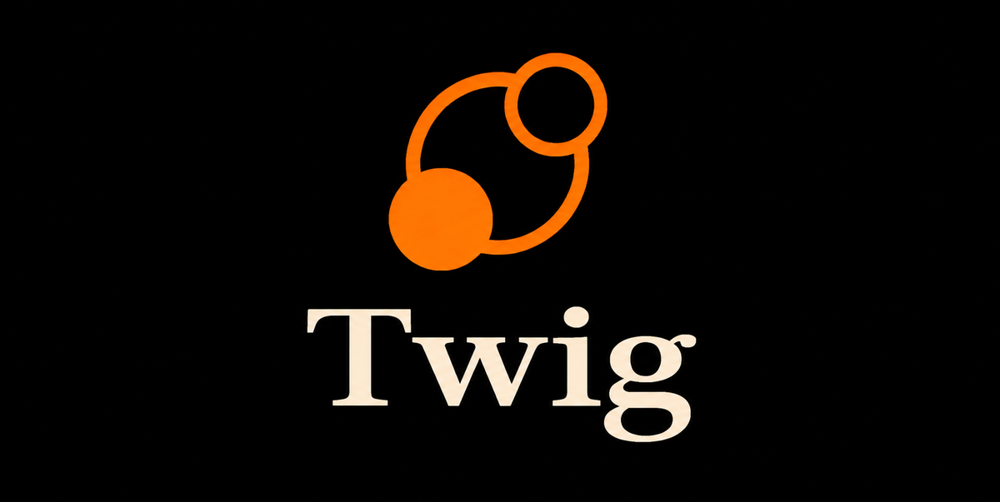
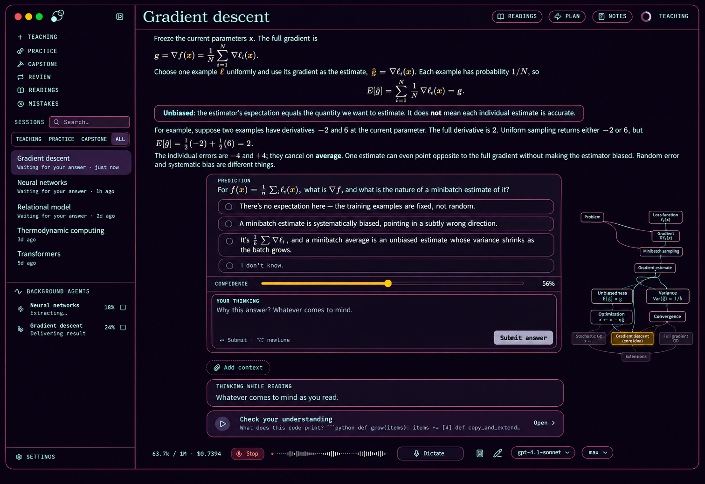

<p align="center">
  <picture>
    <source media="(prefers-color-scheme: dark)" srcset="docs/assets/twig_logo_transparent.png">
    <source media="(prefers-color-scheme: light)" srcset="docs/assets/twig_banner.png">
    
  </picture>
</p>

<p align="center"><strong>An agent harness for learning.</strong></p>

<p align="center">
  <a href="https://github.com/amoghu1s1/twig/releases">Download</a> ·
  <a href="#how-it-works">How it works</a> ·
  <a href="docs/README.md">Documentation</a> ·
  <a href="https://github.com/amoghu1s1/twig/issues">Issues</a> ·
  <a href="https://discord.gg/5tCHHQEB2e">Discord</a>
</p>

> Twig is a fork of [LearnHarness](https://github.com/amosblomqvist/learnharness), renamed and packaged separately so both can run side by side. Original work © Amos Blomqvist, AGPL-3.0.

Twig uses AI agents to plan and teach lessons from your current understanding to your goal. It builds a detailed picture of what you understand and how you reason. That picture is updated as you learn.

Instead of just giving you an explanation, it uses your answers and thinking to decide what you need next. Teaching builds understanding one reasoning step at a time. Practice makes it usable. A persistent knowledge graph carries it across sessions.



## What is different in Twig

Twig keeps LearnHarness's teaching model and adds the parts that matter for daily personal use:

- **FSRS-6 review** — completed practice becomes a derived spaced-repetition queue. Review sessions are ordinary practice sessions; nothing is written back to the graph. See [review-plan.md](docs/review-plan.md).
- **Code exercises in four languages** — the teacher can pose runnable exercises in **Python, JavaScript, TypeScript and C++**. Python runs in bundled Pyodide, JS/TS in an opaque-origin worker, and C++ through a locally detected `clang++`/`g++` with bounded compile/run limits.
- **Read by sentence** — a full-screen reading mode for finished teacher prose. Reveal one sentence at a time with blur/hide/dim, adjustable type, optional **ElevenLabs** read-aloud, browser-voice fallback, `Mod+R` on the latest passage, and `gg`/`G` session navigation. See [keyboard.md](docs/keyboard.md#read-by-sentence).
- **Readings** — generated primer/overview/deep-dive/recap/node readings with a frozen lesson snapshot and a citation law: only sources actually fetched in that run may be cited; Discuss lets you talk through a passage. See [readings.md](docs/readings.md).
- **Themes** — eleven presets plus **Dark / Light / System** mode, server first paint, Electron chrome sync, and WCAG-checked muted/status colors. See [themes.md](docs/themes.md).
- **Graph exports** — send the knowledge graph to **Anki** with stable ids and reviewable note types, or export it to an **Obsidian** vault as linked Markdown; a tidy-graph review proposes merges, splits and connections. See [anki.md](docs/anki.md), [obsidian.md](docs/obsidian.md), [tidy-graph.md](docs/tidy-graph.md).
- **Side questions and notes** — ask about a passage without derailing the lesson; each thread stays attached to the block it came from. Per-lesson notes live beside the transcript, support quote-to-notes, and survive reloads.
- **Session attachments** — attach PDFs, EPUBs, images and other files from the composer; contents are stored once by content hash under `data/attachments/`, previewed from the session, and read through scoped PDF/EPUB tools. Removing an attachment is reversible, and unreferenced blobs are swept.
- **Mistakes review** — every miss is classified, analyzed, and collected on a Mistakes page with a short "why" for each one. The analyst is opt-out and cost-capped.
- **Quote into the composer** — select tutor prose and quote it directly into your reply, so follow-ups keep the exact wording.
- **Capstone projects** — a project session where you pitch a real build from graph propositions, the agent sharpens it into a locked brief with file-verifiable criteria, then reviews your directory read-only and reports the gaps. See [capstone.md](docs/capstone.md).
- **Scratchpad and calculator** — a pressure-sensitive drawing sidebar with undo/eraser/straight lines, a draggable scientific calculator, and inert `svg` figures rendered directly in lessons.
- **Edit the last message** — rewrite a sent prompt or a parked steer with a durable rewind of the transcript, plan, graph traces, jobs and queued steers.
- **Upstream 0.5.0** — the fork carries upstream's attachments/paperclip, learner-image snapshots, folder imports, PDF import, Exa/Firecrawl/Ollama search, file-access restrictions, atomic store writes, Claude CLI guards, and projection/recovery fixes.
- **Defensive tooling** — SSRF-safe web fetch redirects, bounded regex/pre-read limits, and a sandboxed demo/SVG surface.
- **Twig identity** — the transparent Twig mark, app title, package/desktop identity, app icon and release metadata are Twig-branded; attribution to LearnHarness remains.

## How it works

1. **Measure.** Before teaching, the agent finds where your understanding ends on each part the lesson depends on. Your answers, confidence, and thinking show it where to start.
2. **Plan.** It works out a dependency map from that starting point to your goal. You can see the plan, and the lesson adapts when your understanding turns out different.
3. **Teach.** Each step builds on something you already understand. You predict, get an explanation, and check your understanding. Confusions are repaired before anything is built on them. The aim is for the goal to feel obviously true, not merely familiar.
4. **Practice.** Separate sessions pose varied problems that require the right knowledge to come to mind without being named first. Problems and hints adapt to your reasoning. Completed practice feeds the spaced-review queue.

**Think out loud.** The thinking fields let you explain your reasoning, uncertainties, and reactions in your own words. This is how the agent gets a detailed picture rather than just a record of right and wrong answers. You can type or use dictation.

**Read at your pace.** *Read by sentence* turns a finished teacher passage into a full-screen reading surface: one sentence at a time, optional read-aloud, and keyboard navigation. *Readings* can also generate a primer, overview, deep dive, recap or node-specific reading from the lesson's frozen snapshot.

**Bring your files.** In the desktop app, attach PDFs, EPUBs, photos, or other files with the paperclip, or drag them in. Files can stay where they are (the message carries the path) or be attached once to the session and stored locally by content hash; the agent gets a scoped reader for each.

The agent can also research questions in the background, create visual explanations, show your own images in the lesson and mark them up with arrows and labels, and build interactive demonstrations.

## Knowledge that carries forward

What you are taught accumulates as propositions and reasoning chains: individual claims and the premises that lead to them. The graph shows this structure, with links back to the source sessions. You can also import notes.

Future teaching sessions can read the graph instead of starting from scratch. Practice sessions can draw their material from it. It stores the ideas and their connections, not ratings of your ability.


## Download and get started

**[Download the latest Twig release](https://github.com/amoghu1s1/twig/releases)**

- **macOS (Apple Silicon):** signed and notarized DMG. Drag the app to Applications.
- **Windows (x64):** run the installer. It is currently unsigned; Windows may show an “unknown publisher” or SmartScreen warning.
- **Linux (x64):** make the AppImage executable and open it, or install the Debian/Ubuntu `.deb`.

Choose your models, then start a session with what you want to understand. You can use provider API keys, supported subscription connections in the desktop app, an installed [Claude Code CLI](docs/claude-code.md), or a [custom OpenAI-compatible endpoint](docs/custom-providers.md), including a local model server. Optional dictation and web search use separate service keys. Web research can use a Tavily, Brave, Exa, Firecrawl, or Ollama key in Settings → Providers → Search. Ollama search uses its hosted service, not a local model server.

See [Getting started](docs/getting-started.md) for model setup, dictation, files, and notes imports, and [context, caching, and costs](docs/compaction-accounting.md) for advanced cache preferences.

All three platforms support in-app updates.

## Your keys, your data

- **Your keys and models.** No Twig subscription or markup. Billing depends on your provider, CLI configuration, subscription, or local setup. The live cost meter estimates known API costs, not subscription, CLI, or custom-endpoint charges.
- **Local storage.** Your chats, graph, settings, and API keys live on your machine. Learning records are plain files you can inspect.
- **External services.** Models run through your configured providers. Model requests send the context needed for the task; web research and dictation also contact external services. Local storage does not mean offline processing.
- **Inspectable behavior.** System prompts are visible and editable. The app is open source under the AGPL-3.0 license.

## Development and support

```bash
npm ci
npm run dev        # http://localhost:3000
npm test           # fixtures and fake providers
```

See the [documentation index](docs/README.md) for all guides, [development](docs/development.md) for setup and checks, [architecture](docs/architecture.md) for the runtime, [keyboard shortcuts](docs/keyboard.md), and [desktop builds and releases](docs/desktop-release.md).

Questions, bug reports, and feature requests: [GitHub Issues](https://github.com/amoghu1s1/twig/issues).

## License

[AGPL-3.0](LICENSE)

The app is free and open forever. If we ever charge for anything, it will be for convenience — managed keys, hosting — never for features you can run locally.
