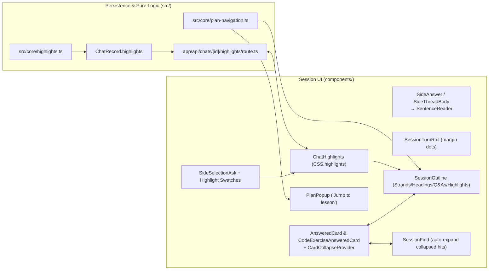

# Implementation Plan — Highlighting, Collapsible Cards, Side-Chat Reader & Session Navigation

## Goal Description

Add four study-workflow upgrades to Twig that make long tutoring sessions feel like clean, navigable, annotated study notes:

1. **Persistent multi-color text highlighting** in main tutor prose and side-chat answers (4 color swatches, persisted on `ChatRecord`, rendered non-destructively via the CSS Custom Highlight API).
2. **Collapsible prediction / check / question / code cards** (collapsed by default except the most recent answered card, mirroring side-chat bars, with per-chat `localStorage` overrides).
3. **Sentence Reader ("Read by sentence") in side-chats** (inline `SideChatWindow` answers and floating/docked `SideThreadBody` answers open the existing `SentenceReader` overlay).
4. **Session search & navigation**:
   - **Plan-strand teleport**: "Jump to lesson" action in `PlanPopup` alongside "Read deeper".
   - **Vertical turn-rail scrubber**: modern dot rail along the chat margin tracking scroll position with hover previews and click-to-jump.
   - **Session Outline popover**: quick jump list for plan strands, prose headings, answered questions, and saved highlights.
   - **Expanded `Mod+F` search**: finds matches inside collapsed side-chats and collapsed question cards, auto-expanding the container when stepping to a match.

---

## Locked Design Decisions

- **Text highlighting**:
  - Persisted in the chat JSON record (`ChatRecord.highlights`).
  - Multiple color swatches (`yellow`, `green`, `blue`, `pink`).
  - Works in both main tutor prose and side-chat answers.
  - Click an existing highlight to change its color or remove it.
- **Plan-strand teleport**:
  - Clicking a visited/current node in `PlanPopup` shows a **"Jump to lesson"** button right next to **"Read deeper"**.
  - Clicking closes the popup and scrolls to the start of that strand's teaching (the first tutor prose message after the previous strand's last tagged check, or after `plan_init` for the first strand, falling back to the node's first check).
- **Session search & navigation**:
  - `Mod+F` searches inside collapsed side-chats and collapsed question cards, auto-expanding the container when stepping to a match.
  - Add a quick **Session Outline** popover (list of plan strands + headings + questions + highlights).
  - Add a **vertical turn-rail scrubber** (margin dots tracking active turn, hover preview, click to jump).
- **Collapsible prediction / check / question / code cards**:
  - All answered cards (`Prediction`, `Check`, `Explain`, `Question`, `Probe`, `Recall`, `Code`) are collapsible into a one-line bar like side-chats.
  - **Collapsed by default** except the **most recent answered card** in the session, so long sessions stay compact and note-like.
  - Manual expand/collapse overrides persist per chat in `localStorage`.

---

## Architecture Overview



---

## Proposed Changes

### 1. Persistent Multi-Color Text Highlighting

#### [NEW] `src/core/highlights.ts`
Pure types, validation, and ID generation:
- `HIGHLIGHT_COLORS = ["yellow", "green", "blue", "pink"] as const` and `HighlightColor` type.
- `ChatHighlight`:
  ```ts
  export interface ChatHighlight {
    id: string;
    sourceKind: "tutor" | "side";
    /** Native messageId for tutor prose, or sideChat threadId for side answers. */
    sourceId: string;
    /** SideChatMessage.id when sourceKind === "side". */
    sideMessageId?: string;
    selector: TextSelector;
    color: HighlightColor;
    createdAt: string;
  }
  ```
- `parseHighlightCreate`, `parseHighlightUpdate`, `newHighlightId`, and `HighlightInputError`.

#### [MODIFY] `src/core/contracts/chat.ts` & `src/core/index.ts`
- Add `highlights?: ChatHighlight[]` to `ChatRecord` (deliberately outside `messages` — never read by agents, compaction, or extraction, matching `notes` and `sideChats`).
- Re-export `src/core/highlights.ts` from `src/core/index.ts`.

#### [MODIFY] `src/store/chats.ts` & `src/server/chats.ts`
- Add atomic per-field store methods (`readHighlights`, `addHighlight`, `updateHighlightColor`, `deleteHighlight`) that read-modify-write `record.highlights` without bumping `updatedAt` (so highlighting never reorders the sidebar).

#### [NEW] `app/api/chats/[id]/highlights/route.ts`
- `GET`: returns `{ highlights: ChatHighlight[] }`.
- `POST`: validates and appends a `ChatHighlight`, returns `{ highlight }` (201).
- `PATCH`: `{ highlightId, color }` updates color, returns `{ highlight }`.
- `DELETE`: `?highlightId=...` removes a highlight, returns `{ ok: true }`.

#### [NEW] `components/highlights.tsx`
- `ChatHighlightsProvider` + `useChatHighlights()` managing optimistic state synced with `/api/chats/[id]/highlights`.
- Injects a single `<style id="lh-user-highlights-style">` element (same Tailwind v4 workaround used in `components/session-find.tsx`) defining:
  - `::highlight(lh-hl-yellow)`, `::highlight(lh-hl-green)`, `::highlight(lh-hl-blue)`, `::highlight(lh-hl-pink)` with theme-safe `color-mix(in oklab, ...)` translucent backgrounds.
- Re-anchors each `ChatHighlight` into live DOM `Range`s using `readSourceText`, `rawRangeFor`, and `chunkPoint` from `components/selection-text.ts` (so highlights work seamlessly across markdown and KaTeX without mutating React's DOM).
- Publishes ranges into `CSS.highlights` (`lh-hl-<color>`, `priority = 0` so `SessionFind`'s `priority = 1` active match always paints on top). Re-syncs on a rAF-debounced `MutationObserver` when side-chats open or content settles.
- **Click-to-manage popover**: listens for collapsed clicks inside the transcript; hit-tests active highlight `Range`s via `getClientRects()`; if clicked, opens a compact floating pill with the 4 color swatches (active color ringed) + a Delete (`Trash2Icon`) button.

#### [MODIFY] `components/side-chat.tsx` & `components/chat.tsx`
- Tag `SideAnswer` containers with `data-highlight-side-thread={threadId}` and `data-highlight-side-message={message.id}` so selections inside side-chat answers can be captured and re-anchored cleanly.
- Extend `SideSelectionAsk` so selecting text in main tutor prose OR side-chat answers shows a **Highlight** button / compact 4-color swatch strip alongside existing *Ask about this* / *Quote* / *Add to notes* actions.

---

### 2. Collapsible Prediction / Check / Question / Code Cards

#### [NEW] `components/card-collapse-state.tsx`
- `CardCollapseProvider` + `useCardCollapse(cardId, defaultOpen)` context scoped per `chatId`:
  - Stores manual user overrides (`Record<string, boolean>`) in `localStorage` under `lh:card-collapse:<chatId>`.
  - Default rule: **collapsed by default**, except the **most recent answered card** in the session (passed as `latestAnsweredCardId` from `chat.tsx`), which defaults to **expanded**.
  - Exposes `setOpen(cardId, open)` and `isOpen(cardId)` on the store so `SessionFind` and `SessionOutline` can imperatively auto-expand a card before scrolling to it.

#### [MODIFY] `components/answered-card.tsx` & `components/code-exercise-answered-card.tsx`
- Accept `cardId` (e.g. `toolCallId`) and `defaultOpen?: boolean`.
- **Collapsed view** (mirroring `SideChatWindow`'s collapsed bar in `components/side-chat.tsx`):
  - Full-width one-line button (`data-testid="answered-card-bar"`, `data-answered-card={cardId}`, `aria-expanded={false}`):
    - `<ChevronRightIcon />` + kind label (`Prediction`, `Check`, `Explain`, `Question`, `Probe`, `Recall`, or `Code · Python`) + verdict `StatusBadge` (if graded) + truncated question excerpt + optional confidence `%` on the right.
- **Expanded view**:
  - Top header row becomes a clickable collapse bar (`<ChevronDownIcon />` + kind label + verdict badge) matching `SideChatWindow`'s header toggle.
  - Add a subtle bottom-left `<ChevronUpIcon />` collapse button (matching `side-chat-collapse-bottom`) that collapses the card and keeps its bar in view via `scrollIntoView({ block: "nearest" })`.
  - Keep `ThinkingBlock` tucked cleanly with the card so when collapsed, the one-line bar stays compact and note-like.

#### [MODIFY] `components/chat.tsx`
- Compute `latestAnsweredCardId` (the `toolCallId` of the last answered `tool-quiz` / `tool-probe` / `tool-ask_user_question` / `tool-explain` / `tool-recall` / `tool-code-exercises` part in `messages`).
- Wrap the transcript in `<CardCollapseProvider chatId={chatId} ...>` and pass `cardId={part.toolCallId}` and `defaultOpen={part.toolCallId === latestAnsweredCardId}` to `AnsweredCard` and `CodeExerciseAnsweredCard`.

---

### 3. Extend Sentence Reader ("Read by sentence") to Side-Chats

#### [MODIFY] `components/side-chat-state.tsx` & `components/side-chat.tsx`
- Add an optional `onOpenReader?: (passage: { text: string; partId: string }) => void` callback on `SideChatStore` (wired in `chat.tsx` to `setReaderPassage({ text, partId, sideEnabled: false })`).
- In `SideAnswer`, render `<SentenceReaderButton onOpen={() => store.openReader(message.text, `side:${threadId}:${message.id}`)} />` above settled non-empty assistant answers (when not streaming).

#### [MODIFY] `components/side-thread.tsx` & `components/chat.tsx`
- Add optional `onOpenReader?: (text: string, partId: string) => void` to `SideThreadHandlers`.
- In `SideThreadBody`, render `<SentenceReaderButton />` on settled assistant messages (`message.role === "assistant"` with non-empty `message.text`).
- Wire `onOpenReader` in `chat.tsx` to `setReaderPassage({ text, partId, sideEnabled: false })`.

---

### 4. Session Search & Navigation

#### 4A. Plan-Strand Teleport

##### [NEW] `src/core/plan-navigation.ts`
- Pure helper `planNodeJumpTargets(tree: PlanTree, messages: readonly LhViewMessage[]): Map<string, string>` (maps `nodeId` → target `messageId` anchor):
  - Walks messages in order, tracking position-tagged calls (`quiz`, `explain`, `code-exercises`, plugin teach questions — same rule as `derivePlanStatuses` in `src/core/contracts/plan.ts`).
  - Records the `plan_init` boundary and each strand transition.
  - For each visited or current `nodeId`, resolves the **start of that strand's teaching**: the first assistant text message after the previous strand's last tagged check (or after `plan_init` for the first strand), falling back to the message carrying that node's first tagged check.
- Re-export from `src/core/index.ts`.

##### [MODIFY] `components/plan-block.tsx` & `components/chat.tsx`
- Add `onJumpToNode?: (nodeId: string) => void` and `jumpableNodes?: ReadonlySet<string>` props to `PlanPopup`.
- In `PlanPopup`'s picked-node pill, add a **"Jump to lesson"** button right beside **"Read deeper"** (disabled with tooltip `"Not taught yet"` for `upcoming` nodes).
- Clicking **Jump to lesson** closes `PlanPopup` and calls `scrollToMessageAnchor(targetMessageId)` (scrolling to `#message-<id>` via `scrollSessionTarget` + a brief accent highlight pulse).

#### 4B. Vertical Turn-Rail Scrubber

##### [NEW] `components/session-turn-rail.tsx` & `[MODIFY]` `components/chat.tsx`
- Subtle vertical rail of dots anchored to the right margin of the chat viewport (`pointer-events-auto absolute right-2 top-1/2 -translate-y-1/2 z-20`), hidden when `< 2` turns or on narrow screens (`hidden xl:flex`).
- Each dot represents one conversation turn (anchored to its message DOM element via `data-turn-index`), displaying:
  - Active dot: brighter/solid (`bg-foreground/70`), inactive dots: muted (`bg-muted-foreground/30 hover:bg-muted-foreground/70`).
  - Hover tooltip to the left of the dot showing a compact 1-line preview (turn # + user prompt or tutor heading/strand label).
  - Click: smoothly scrolls the conversation container to that turn.
- Tracks active turn cleanly via `IntersectionObserver` (with scroll-container root).

#### 4C. Session Outline Popover

##### [NEW] `components/session-outline.tsx` & `[MODIFY]` `components/chat.tsx`
- Adds a compact **Outline** chip in `chat.tsx`'s `TopBar` (beside `Plan` and `Notes`).
- Opens a clean, filterable popover/drawer with quick-filter input and 4 compact sections:
  1. **Strands**: plan nodes with status indicator (current/visited/upcoming) → jumps to strand start.
  2. **Headings**: `##` / `###` headings extracted from tutor prose → jumps to that heading.
  3. **Questions**: answered Prediction / Check / Explain / Question / Code cards with verdict badge → jumps to and auto-expands the card.
  4. **Highlights**: all saved `ChatHighlight`s with their color dot and quoted text → jumps to the highlight (auto-expanding its side-chat if inside a collapsed side-chat).

#### 4D. `Mod+F` Search Across Collapsed Side-Chats & Collapsed Question Cards

##### [MODIFY] `components/session-find-dom.ts` & `components/session-find.tsx`
- Introduce a unified `SessionFindMatch` union:
  - `{ kind: "dom"; range: Range; identity: SessionRangeIdentity }` (existing visible DOM matches)
  - `{ kind: "collapsed-side"; threadKey: string; containerEl: HTMLElement; matchOffset: number; text: string }`
  - `{ kind: "collapsed-card"; cardId: string; containerEl: HTMLElement; matchOffset: number; text: string }`
- Merge visible DOM matches and collapsed-container matches in **DOM document order** (using `Node.compareDocumentPosition` against each collapsed bar element).
- Update the match counter (`index/count`) to include collapsed matches.
- When `step()` (or initial `selectFirst`) lands on a collapsed match:
  - Call `onRevealCollapsed(match)` (`sideStore.setOpen(threadKey, true)` or `cardCollapse.setOpen(cardId, true)`).
  - On the next animation frame (once React mounts the expanded content), re-run `sessionFindRanges` to resolve the now-visible DOM `Range` inside that container, highlight it with `SESSION_FIND_ACTIVE_HIGHLIGHT`, and scroll it into view.

---

## Verification Plan

### Automated Tests
1. New unit & UI tests in `tests/`:
   - `tests/highlights.test.ts`: pure validation (`parseHighlightCreate` / `parseHighlightUpdate`), `ChatStore` highlight CRUD (verifying `updatedAt` is untouched and `highlights` never leak into `toLlmMessages`), and `/api/chats/[id]/highlights` route tests.
   - `tests/plan-navigation.test.ts`: `planNodeJumpTargets` across linear plans, multi-check strands, revisited strands, and upcoming nodes.
   - `tests/card-collapse.test.tsx`: `AnsweredCard` & `CodeExerciseAnsweredCard` default-collapsed (older) vs default-expanded (latest) behavior, toggle bar, and `localStorage` persistence.
   - `tests/side-chat-reader.test.tsx`: `SentenceReaderButton` rendering and callback invocation in `SideAnswer` and `SideThreadBody`.
   - `tests/session-find-collapsed.test.tsx`: `SessionFind` matching text inside collapsed side-chats and collapsed answered cards, auto-expanding on step.
2. Existing checks:
   ```bash
   npm run typecheck
   npm test
   npm run style-check
   ```

### Manual Verification
1. Open an existing long session (e.g. *Calculus III*) in Twig:
   - **Highlights**: Select text in both tutor prose and a side-chat answer → apply Yellow/Green/Blue/Pink highlight → reload page → verify highlights persist cleanly across markdown and KaTeX → click a highlight to recolor or remove it.
   - **Collapsible cards**: Verify older Prediction/Check/Question cards render as neat 1-line bars while the newest answered card is expanded; click to expand/collapse and verify state persists across reload.
   - **Side-chat reader**: Open an inline side-chat (and floating side-thread), click **Read by sentence** on an assistant answer, and verify `SentenceReader` opens with full controls.
   - **Navigation & Search**:
     - Open **Plan**, click a visited node, click **Jump to lesson**, verify teleport to the start of that strand.
     - Scroll the session and verify the right-margin turn-rail dots track position, preview on hover, and jump on click.
     - Open **Outline** chip, filter and jump to a strand, heading, question, and highlight.
     - Press `Mod+F` and search for a word that only exists inside a collapsed side-chat or collapsed question card → press `Enter` → verify the container auto-expands and highlights the match.
